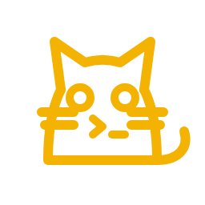
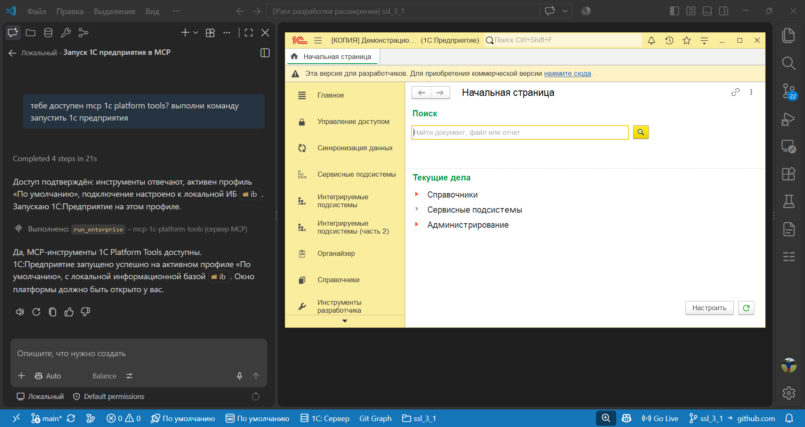

# AI-агенты

>  Навыки объясняют агенту команды расширения, MCP даёт их вызвать.

Расширение помогает AI-агентам (Cursor, Claude, Copilot) работать с проектом 1С: агент узнаёт, какие команды есть, и выполняет их через [MCP-сервер](/mcp/) или файл-триггер.



## Навыки для агента

В дереве **1С: Инструменты** → раздел **Навыки для AI**:

- **Добавить навыки разработки 1С (cc-1c-skills)**: XML, формы, роли, СКД, метаданные; скачиваются с GitHub при каждом вызове.
- **Добавить навыки расширения (команды и MCP)**: инструкции по командам расширения и MCP по доменам.
- **Добавить навыки OneScript**, **Vanessa Automation**, **YAxUnit** и **xUnit**: скачиваются с GitHub при каждом вызове (репозитории `yellow-hammer/skills-onescript`, `skills-vanessa-automation`, `skills-yaxunit`, `skills-xunit`). Папка зависит от кнопки: Cursor (`.cursor/skills` и `.cursor/rules`), GitHub Copilot (`.github/skills` и `.github/instructions`), Claude Code (`.claude/skills` и `.claude/rules`). Команда «Добавить навыки YAxUnit» не ставит движок тестов: для движка есть «Добавить YAxUnit».

При установке выбирается папка назначения: `.cursor/skills/`, `.github/skills/`, `.claude/skills/` или другая, которую использует агент.

## Файл-триггер

Агент может создать файл `.cursor/1c-platform-tools-run-command` с одной строкой: идентификатором команды:

```txt
1c-platform-tools.run.designer
```

Расширение выполнит команду и удалит файл.

## MCP-сервер

Прямой вызов команд с результатом, счётчиками тестов и параметрами вызова даёт отдельное расширение **1C: Platform Tools MCP**. Установка, подключение к VS Code и Cursor, параметры инструментов и примеры фраз для агента собраны в разделе [MCP-сервер](/mcp/).

Данные базы агент читает через стандартный интерфейс OData, см. [Данные через OData](odata.md).
