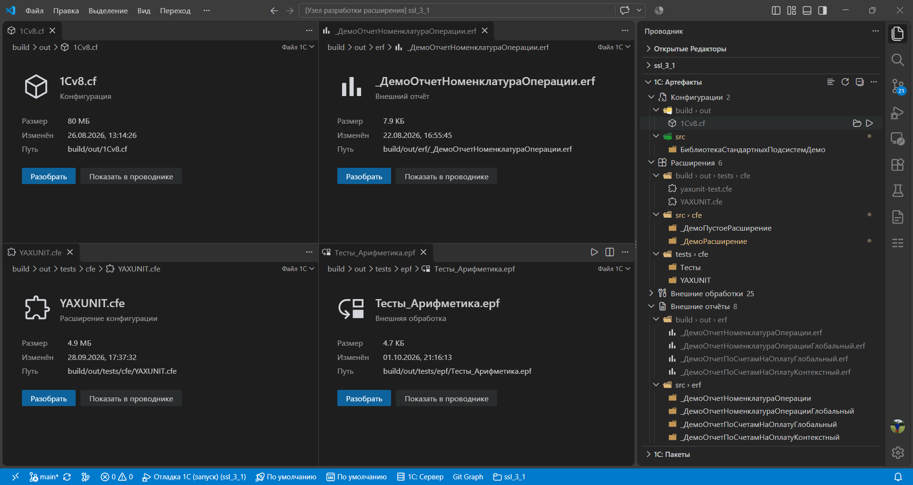

# 1С: Артефакты

>  Кнопка «Разобрать» появляется прямо в редакторе бинарного файла.

Панель **1С: Артефакты** в Проводнике показывает поддерживаемые файлы проекта: конфигурации (`*.cf`), расширения (`*.cfe`), внешние обработки (`*.epf`), отчёты (`*.erf`), пакеты OneScript (`*.ospx`) и соответствующие каталоги исходников. Сценарии Vanessa (`*.feature`) живут в [панели тестирования](testing.md), не здесь. Проекты EDT стоят в тех же разделах с пометкой `EDT`.

## Действия

- Из дерева: **Открыть**, **Собрать**, **Разобрать**. У пакета на исходнике **Собрать пакет**, на собранном файле **Установить пакет**. В контекстном меню: те же команды и **Удалить**.
- Бинарный файл открывается карточкой: вид файла, размер, дата изменения и кнопка действия. У конфигурации, расширения, обработки и отчёта это **Разобрать**, у пакета **Установить**.

Сборка и разбор конфигурации, расширения, обработки и отчёта выполняются командами vanessa-runner: собранный файл предлагается в каталоге сборки, разобранный исходный код в каталоге объекта. Куда именно, спрашивается перед запуском.

## Настройки

`1c-platform-tools.artifacts.exclude`: сегменты пути, исключаемые при сканировании артефактов (например `oscript_modules`, `build`).
