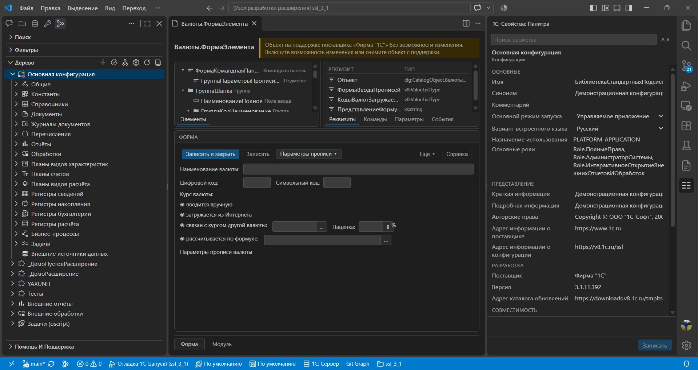

# 1С: Метаданные

>  Всё, что нужно дереву, расширение приносит само.

Панель **«1С: Метаданные»** показывает дерево исходного кода конфигурации, её расширений, внешних отчётов и обработок, включая тестовые, и позволяет создавать и редактировать объекты.

Панель состоит из плашек **Поиск**, **Фильтры**, **Дерево** и **Помощь и поддержка**. По умолчанию развёрнуто только дерево.

Смена текущего проекта сбрасывает отбор по подсистемам.

## Первый запуск

Откройте панель **«1С: Метаданные»**: всё, что ей нужно, расширение скачает само. Свои сборки, автозагрузка,
обновление и работа без доступа к GitHub описаны в разделе [Внешние компоненты](components.md).

## Поиск по дереву

Плашка **Поиск** содержит поле над деревом: по мере ввода в дереве остаются объекты, имя которых содержит подстроку. Пустое поле снимает отбор. Поиск не разворачивает дерево целиком, поэтому на больших конфигурациях остаётся быстрым.

Кнопка **Свернуть** в шапке дерева схлопывает все узлы.

## Переход к объекту из файла

Команда **«1С: Метаданные: Показать в дереве»** (Ctrl+Alt+T) находит в дереве объект, которому принадлежит открытый файл, и выделяет его. Она же лежит в контекстном меню редактора, вкладки и проводника.

Если объект скрыт поиском или отбором по подсистемам, команда предложит сбросить отбор, а не промолчит.

Работает от любого файла исходного кода, а не только от XML объекта: модуль, описание формы и её содержимое ведут к своему узлу, `Configuration.xml` - к корню.

## Фильтр по подсистемам

Плашка **Фильтры** показывает дерево подсистем конфигурации с флагами. Отметка применяется сразу: в дереве метаданных остаются объекты, входящие в состав отмеченных подсистем. Отмеченных может быть несколько, их составы объединяются.

Два переключателя расширяют состав отбора:

| Переключатель                            | Что добавляет                                                        |
|------------------------------------------|----------------------------------------------------------------------|
| Включать объекты подчинённых подсистем   | состав всех подсистем ниже отмеченной                                |
| Включать объекты родительских подсистем  | состав подсистем выше отмеченной по ветке                            |

Поле поиска над деревом подсистем ищет по их именам. **Очистить фильтр** снимает все отметки, **Свернуть** схлопывает дерево подсистем.

Отдельная команда **Фильтр по подсистеме** в контекстном меню подсистемы в дереве метаданных отбирает по ней сразу.

## Редактирование свойств объекта

**Свойства** в контекстном меню открывают вкладку с формой объекта. Пункт один на все узлы дерева: конфигурация, расширение, объект, внешний отчёт и обработка открываются одинаково. Вкладка на объект тоже одна - повторный вызов покажет уже открытую, соседний объект откроет свою.

Вкладки повторяют конфигуратор: **Основные**, **Данные**, вкладка сути вида (адресация, компоновка, субконто, расчёт, движения, регистрируемые документы, обмен данными), **Формы**, **Команды**, **Макеты**, **Ввод на основании**. Чего у вида не бывает, того и не показывается.

Правки копятся в панели и уходят в файлы по кнопке **Сохранить**.

Синонимы, представления и подсказки правятся на основном языке конфигурации: когда он не русский, его код стоит в подписи свойства. Тексты на других языках остаются как были.

Расширение правит XML точечно: меняются только затронутые строки, остальной файл, включая форматирование и порядок элементов, остаётся как был. Это держит diff в Git читаемым.

 Панель идёт за версией формата вашей выгрузки: свойства, которого в этой версии нет, вы не увидите и в файл его не запишете, а значение, которого версия не знает, в списке не предложится.

### Состав объекта

Реквизиты, табличные части, измерения, ресурсы, значения перечисления, команды и признаки учёта ведутся одинаково: добавить, переименовать, дублировать, удалить, переставить, поправить синоним и тип. Список стоит на своей вкладке: реквизиты и табличные части на «Данных», команды на «Командах», макеты на «Макетах».

Те же действия есть в дереве: **Добавить** на разделе состава, **Переименовать**, **Дублировать**, **Удалить** и **Изменить тип** на самом узле. Тип отмечается галочками в списке: примитивы платформы и ссылочные типы конфигурации, несколько отмеченных дают составной тип.

Тип правится там же: у примитива меняется вид и квалификаторы (длина, точность, состав даты), а составной тип ведётся списком - плашка с крестиком убирает тип, строка **+ Тип…** добавляет. В палитре свойств одиночный тип выбирается списком прямо в строке; составной там показывается строкой, а меняется пунктом **Изменить тип** в дереве, где отмеченные типы идут первыми. В кандидатах примитивы платформы и ссылочные типы конфигурации, сгруппированные по видам объектов.

Если при смене типа реквизита прежнее значение заполнения (строка, число, булево или дата) к новому типу не подходит, md-sparrow заменяет его пустым: пустой строкой, когда новый тип только строка, иначе «Неопределено». Значение конфигурации (например, значение другого перечисления) и значение при определяемом типе или характеристике в новом типе не трогаются.

 Новый элемент создаётся со строковым типом. У команды объекта дублирования нет, а её модуль переезжает и удаляется вместе с ней.

### Формы

На вкладке **Формы** щелчок по имени открывает форму, крестик удаляет её вместе с файлами, **+ Форма…** создаёт пустую управляемую форму из эталона платформы. То же самое есть в дереве на разделе «Формы» и на самой форме.

### Подсистемы, права и составы

| Что открыть | Где | Что можно |
|-------------|-----|-----------|
| Подсистемы объекта | вкладка «Подсистемы» | отметить участие флажками, запись идёт в состав подсистем |
| Права роли | вкладка «Права» у роли | кросс-таблица «объекты × права», флаги прав по умолчанию, фильтр по имени и виду |
| Права ролей на объект | вкладка «Права» у объекта | таблица «роли × права вида», поиск роли, ограничения доступа и права подчинённых у выбранной роли |
| Командный интерфейс | вкладка у подсистемы или пункт меню | видимость команд, размещение по группам, порядок команд, подсистем и групп |
| Состав | вкладка «Состав» | дерево с флажками у подсистемы, функциональной опции и её параметра, общего реквизита, последовательности, плана обмена |

Права ведут себя как в конфигураторе: выданное право тянет зависимые, снятие базового снимает зависимые. По умолчанию видны объекты с выданными правами, флажок «Все объекты» показывает всю конфигурацию.

 Состав критерия отбора в панели только снимается: добавить в него ссылку нельзя.

### Конфигурация и расширение

У конфигурации перечислимые свойства подписаны словарём формата, назначения использования отмечаются флажками, основные роли ведутся плашками: крестик убирает роль, **+ Роль…** подбирает из ролей конфигурации.

### Когда правка закрыта

Происхождение объекта видно плашкой в шапке панели: «Заимствованный» у объекта расширения, «На поддержке» у объекта поставщика с поставщиком и версией в подсказке. Закрытый объект открывается только на просмотр: поля недоступны, кнопки записи нет, причина написана строкой над вкладками. Так же ведут себя свойства конфигурации, просмотр формы и палитра свойств. Вкладка «Права» у закрытого объекта правится: права ролей закрывает поддержка роли, а не объекта.

В дереве пункты меню остаются на месте и при запрете: вызов правки отвечает подсказкой, что делать дальше.

Заимствованный объект расширения правится в тех свойствах, которые расширение вправе менять: у такого поля стоит отметка «контролируется», пока значение сверяется с расширяемой конфигурацией, и «изменено», когда его задало расширение. Запись сама ставит «изменено». Остальные свойства принадлежат расширяемой конфигурации и открыты только на просмотр, комментарий у заимствованного свой. Состав заимствованного объекта в панели только смотрят. В дереве такой объект помечен жёлтым кружком с буквой **А** в правом верхнем углу пиктограммы.

## Поддержка поставщика

Работа с поддержкой включена по умолчанию. Настройка `metadata.supportEnabled` её выключает: тогда выгрузка правится так, будто поставки нет, признаков в дереве не появляется, отказов в правке тоже.

Возможность изменения конфигурации включают в конфигураторе. Пока она не включена, конфигурация закрыта целиком: правило не меняется ни у объекта, ни у корня, правка объектов отклоняется.

 Не поднимайте флаг возможности изменения в файле правил руками: такую выгрузку платформа не загрузит. Включать возможность изменения умеет только конфигуратор.

Состояние видно в дереве признаками на пиктограмме, по одному на угол:

| Признак | Угол | Что означает |
|---------|------|--------------|
| Бледно-жёлтый квадрат | слева снизу | объект на поддержке |
| Янтарный замок | справа сверху | правило «не редактируется» |
| Красный круг с чертой | справа снизу | возможность изменения не включена, доступно только снятие с поддержки |

Круг с чертой стоит на корне конфигурации и уходит, как только конфигуратор включит возможность изменения; замок после этого остаётся, пока у субъекта правило «не редактируется». Те же признаки идут на разделы, узлы состава и листья внутри подсистем. В свойствах конфигурации состояние показано плашкой в шапке, а причина запрета - строкой над вкладками.

Правило ставится пунктом **Режим поддержки** любому субъекту: самой конфигурации, объекту, его форме, макету, реквизиту, табличной части, измерению, ресурсу, значению перечисления и команде. Правила и порядок как в окне конфигуратора:

| Правило | Что означает |
|---------|--------------|
| Объект поставщика не редактируется | остаётся на поддержке, правка закрыта |
| Объект поставщика редактируется с сохранением поддержки | правка разрешена, поддержка сохраняется |
| Объект поставщика снят с поддержки | поставщик больше не управляет объектом |

Следом спрашивается область: без подчинённых объектов или с ними. У конфигурации подчинённые - вся выгрузка, у объекта - его формы, макеты и элементы. Правило корня открывает свойства конфигурации и добавление объектов.

 Если правила успел изменить конфигуратор или соседняя сессия, запись отклоняется с просьбой обновить дерево.

Пункт **Снять с поддержки** на конфигурации удаляет правила вместе с поставками из `Ext/ParentConfigurations`: с поддержки снимаются все объекты, выгрузка правится свободно, обновление от поставщика становится недоступно.

## Открытие по клику

Клик по объекту в дереве (или двойной клик, если так настроено в VS Code) вызывает ту же команду, что основной пункт его меню:

- общая форма — **Открыть форму**;
- общий модуль, HTTP-сервис, Web-сервис — **Открыть модуль**;
- остальные объекты — **Свойства**.

Форма внутри справочника или документа открывается кликом по узлу формы. Второй клик по тому же объекту показывает уже открытую вкладку.

## Открытие модулей объектов

В контекстном меню объекта дерева есть пункты открытия его модулей. Набор зависит от вида объекта:

| Пункт меню                       | Файл (`<Объект>/Ext/…`)     | Типы объектов                                                                                          |
|----------------------------------|-----------------------------|-------------------------------------------------------------------------------------------------------|
| Открыть модуль объекта           | `ObjectModule.bsl`          | справочники, документы, отчёты, обработки, планы видов характеристик/счетов/расчёта, планы обмена, бизнес-процессы, задачи |
| Открыть модуль менеджера         | `ManagerModule.bsl`         | те же + журналы документов, перечисления, регистры, константы, хранилища настроек, критерии отбора |
| Открыть модуль набора записей    | `RecordSetModule.bsl`       | регистры (сведений/накопления/бухгалтерский/расчёта)                                                    |
| Открыть модуль менеджера значения| `ValueManagerModule.bsl`    | константы                                                                                               |
| Открыть модуль                   | `Module.bsl`                | общие модули, HTTP-сервисы, Web-сервисы                                                                 |
| Открыть модуль формы             | `Ext/Form/Module.bsl`       | общие формы и формы объектов                                                                            |

Если файла модуля ещё нет, он создаётся пустым и сразу открывается.

## Открытие XML

**Открыть XML** есть у каждого узла, у которого в выгрузке свой файл: у конфигурации и расширения это `Configuration.xml`, у объекта - его XML, у внешнего отчёта и обработки - их файл.

«Свойства» на форме и макете открывают их собственное описание той же вкладкой, что у объекта: имя, синоним, тип формы. У формы пункта два: **Открыть XML** показывает описание формы (имя, синоним, тип), **Открыть XML содержимого** - саму форму с элементами и реквизитами.

## Просмотр формы

Клик по форме в дереве метаданных открывает её вкладкой: дерево элементов, схематичное превью и данные формы (реквизиты, команды, параметры, обработчики). Свойства выделенного элемента показывает панель **«1С: Свойства»**.

Внизу вкладки переключатель **«Форма» / «Модуль»**, как в конфигураторе: «Модуль» открывает `Ext/Form/Module.bsl` соседней вкладкой редактора, с подсветкой и подсказками языка. Если модуля ещё нет, он создаётся пустым.

Закладки списков внизу плашек, как в конфигураторе: у элементов формы - «Элементы», у данных - «Реквизиты», «Команды», «Параметры», «События». Выделение синхронно в дереве и на превью. Клик по обработчику события открывает модуль формы на нужной процедуре.

Превью подписывает элементы так же, как платформа: заголовок элемента, а если его нет - синоним источника. У поля это реквизит формы или реквизит объекта (включая стандартный), у кнопки - команда формы или команда объекта, у переключателя и флажка - представление значения из списка выбора. Свойства, не записанные в файл, показываются со значением по умолчанию: группа без записанной группировки раскладывается горизонтально.

## Табличный документ

Клик по макету табличного документа открывает его листом: ячейки, рамки, объединения и именованные области. Области строк — слева, области колонок — над листом. Параметр макета показан в угловых скобках. Файл `mxl` или `mxlx` открывается тем же просмотром. Схема компоновки по клику в дереве открывается своим редактором, текстовый макет — текстом.

## Схема компоновки данных

Пункт **Открыть схему компоновки** на макете вида «Схема компоновки данных» (в том числе общем) открывает редактор схемы; клик по такому макету в дереве делает то же. Закладки идут в порядке конфигуратора: наборы данных с полями и запросами, связи наборов, вычисляемые поля, ресурсы, параметры, вложенные схемы и варианты настроек. Всё, кроме вложенных схем, правится. Запрос набора правится текстом прямо на закладке или в конструкторе запроса, который устроен как конструктор конфигуратора, вызванный из схемы компоновки. Вариант настроек правится по узлам структуры или собирается по шагам конструктором настроек. **Проверить схему** проверяет файл по XSD компоновки данных с поправками на то, как пишет файлы платформа.

Макет со схемой компоновки создаётся из дерева у раздела **Макеты** объекта и у **Общих макетов**, как в конфигураторе: описание, содержимое с пустой схемой и строка в составе владельца; у отчёта новый макет можно сразу назначить основной схемой. Удаление убирает все три части и очищает ссылку владельца на основную схему. Макеты других видов редактор не создаёт и не удаляет.

### Как записывается файл

- Каждая правка уходит в md-sparrow и меняет в XML только свой узел, остальной файл остаётся байт в байт как был. Правки идут через ту же очередь, что у дерева метаданных и других редакторов, поэтому одновременные правки одного файла не сталкиваются. Битый файл не записывается. После записи схема перечитывается.
- Правка из нескольких операций (ОК конструктора запроса или конструктора настроек, добавление ресурсов по всем полям) уходит одним пакетом: он применяется целиком или не применяется вовсе.
- Текст запроса записывается, когда поле теряет фокус. Пустой текст не записывается. Текст с ошибкой разбора записывается, чтобы набранное не потерялось, но поля по нему не заполняются.
- Автозаполнение дописывает в набор недостающие поля из последнего запроса выборки пакета. Существующие поля не меняются, типы полей, в отличие от конфигуратора, не выводятся, а запрос `ВЫБРАТЬ *` получает отказ: звёздочку разворачивает платформа.
- Конструктор запроса пересобирает только правленые запросы пакета, остальные уходят в файл исходным текстом с комментариями и переносами. Комментарии внутри правленого запроса при сборке пропадают, поэтому перед записью конструктор спрашивает о них. Параметры `&Имя` из текста, которых нет в схеме, объявляются без типа.
- Варианты настроек читаются при первом обращении к ним, а не вместе со схемой. Конструктор настроек, в отличие от конфигуратора, заменяет только структуру, выбранные поля и порядок варианта: отбор, параметры, условное оформление и пользовательские поля остаются. Идентификаторы пользовательских настроек редактор не создаёт и не меняет.
- При смене типа поля или параметра неподходящее значение заменяется пустым значением нового типа или снимается. Это правило редактора и md-sparrow: загрузка в платформу несовместимое значение хранит как записано.
- Правки, которые загрузка в платформу молча отбросила бы, редактор не предлагает, а md-sparrow отклоняет с ошибкой: разрядность числа больше 64, флажок **Обязательная связь**, флажок **Список параметров** у связи без параметра, представления элементов и «Неопределено» рядом с другими значениями в списке значений параметра схемы, параметры вывода, которых не хранит узел структуры. Уже записанные в файле флажки, списки и параметры вывода такого вида редактор помечает предупреждением.

### Подсказки и проверки

- Поля выражений и путей подсказывают имена, а после точки продолжают путь по типу: реквизиты ссылок, состав определяемого типа и характеристики (если в составе не больше шести ссылок), свойства стандартного периода. Тип поля набора-запроса выводится из текста запроса в памяти и в файл не пишется.
- Имена таблиц и полей в запросе сверяются с метаданными под текстом набора и в конструкторе. Проверка только предупреждает: вывод по метаданным знает не всё, а загрузка схемы тексты запросов не проверяет, так что окончательно запрос проверяет платформа при открытии схемы в конфигураторе или при формировании отчёта.
- Конструктор при открытии разбирает текст и собирает его обратно. Если сборка теряет или меняет слова, окно открывается в режиме «только текст» с местом первого расхождения. Синтаксических ошибок эта самопроверка не ловит.
- Запрос на английском открывается так же, правленые запросы собираются на языке текста.
- Дерево «База данных» конструктора строится один раз за сеанс VS Code (на большой выгрузке это минуты) и перестраивается, когда меняется `Configuration.xml`. Правку синонима объекта оно покажет после перезапуска окна.
- **Проверить схему** кроме ошибок выводит предупреждения, которые на её исход не влияют: `&`-параметр запроса не объявлен в схеме, список значений параметра записан старой формой и загрузка потеряет его представления, флажок **Список параметров** записан у связи без параметра.
- Пример в окне форматной строки считает сам редактор, а не платформа: в крайних случаях он может разойтись с функцией `Формат`.

### Ограничения

- Правятся наборы верхнего уровня. Наборы внутри объединения и папки полей показываются, но не правятся; запрос набора внутри объединения меняет только конструктор запроса.
- Вложенные схемы, вложенные отчёты в структуре варианта и пользовательские поля только показываются.
- Значения и типы, которые редактор не разбирает (шрифт, картинка, подпараметры типа диаграммы, таблица значений и другие типы вне словаря), видны с пометкой и правятся в конфигураторе.
- Нельзя копировать варианты настроек, менять их порядок и переставлять поля наборов, связи, вычисляемые поля, параметры, ресурсы и наборы данных: таких операций у md-sparrow нет. Элементы условного оформления тоже не переставляются.
- Конструктор запроса не раскладывает по вкладкам группировку `ПО ГРУППИРУЮЩИМ НАБОРАМ`, объединение с разным числом полей у частей и блок `{ХАРАКТЕРИСТИКИ}`: они правятся текстом. Вкладок **Итоги** и **Построитель** нет, как и у конфигуратора в режиме схемы компоновки. Таблиц изменений, таблиц расширений и внешних источников данных в дереве нет, их пишут в тексте.
- Поддерживаются макеты выгрузки 1C:Конфигуратор (`Ext/Template.xml`) и проекта 1C:EDT (`Template.dcs`). Дерево «База данных» конструктора и проверка имён по метаданным есть только у макета в выгрузке 1C:Конфигуратор; в проекте 1C:EDT поля и типы таблиц читаются из `.mdo` объектов. В выгрузке расширения проверка имён выключена. У макета вне выгрузки (внешний отчёт, отдельный файл) реквизиты ссылок не подсказываются, а новым типом выбираются только примитивы и «любая ссылка».
- Схему в выгрузке форматов 2.10 и 2.11 (платформа 8.3.17 и 8.3.18) редактор не открывает: в XSD этих форматов нет полного набора схем компоновки данных. Макет СКД в них создаётся из дерева, но правится в конфигураторе.

### Команды агента

Схему компоновки агент правит и без открытой панели: семь команд `1c-platform-tools.dcs.*` категории **1С: Схема компоновки данных** (они же инструменты MCP) работают с файлом макета. Относительные пути считаются от корня проекта, правки идут через ту же очередь, что у редактора.

- `dcs.read {path, variant?}`: модель схемы по файлу содержимого макета или его описанию. Без `variant` в ответе список вариантов настроек, с ним настройки названного варианта. Последний ключ модели `typeCompositions` перечисляет составы определяемых типов и характеристик из типов значений полей, вычисляемых полей и параметров: `{source, name?, types, typeSets}`, где `source` это UUID определяемого типа из `typeIds` или набор `cfg:DefinedType.X` / `cfg:Characteristic.X` из `typeSets`. По составу поле разыменовывается через точку, а `valueType` остаётся прежним: в правки `dcs.apply` состав не отправляется. Вне выгрузки конфигурации и без составов ключа нет.
- `dcs.apply {path, op, params}`: одна правка из белого каталога операций СКД (наборы данных и их поля, связи, вычисляемые поля, ресурсы, параметры, варианты настроек, автозаполнение полей, макеты владельца), в ответе свежая модель. Операция вне каталога отклоняется со списком доступных. Правки, которые загрузка в платформу отбросила бы (список выше), отклоняются с ошибкой, и файл не пишется.
- `dcs.validate {path}`: та же проверка, что **Проверить схему**. В ответе `ok`, ошибки с позициями и `warnings` `{message, parameter, dataSet?, kind}` с видами `undeclaredQueryParameter`, `valueListPresentationsLost` и `linkListFlagWithoutParameter`. У последнего вместо `parameter` поле `link`, номер связи с нуля, как `index` у `cf-dcs-set-link`; флажок снимает `dcs.apply` с `op: "cf-dcs-set-link"` и `params: {index, payload: {parameterListAllowed: null}}`. Представления списка убирает только запись списка заново: `op: "cf-dcs-set-parameter"`, `params: {name, payload: {value}}`, где `payload.value` это список (`{type: "v8:ValueListType", list: {items: [{value}]}}`) без `presentation`. `value` рядом с `name` правка отклонит, а `payload.valueListAllowed: false` представлений не убирает.
- `dcs.typeDictionary {path}`: что можно записать новым типом в `payload.valueType` правок `cf-dcs-set-field`, `cf-dcs-set-calculated-field`, `cf-dcs-set-parameter` и `cf-dcs-add-parameter`. Тип записывается той же формой, что `valueType` в модели `dcs.read`. Вне выгрузки конфигурации в словаре только примитивы и «любая ссылка».
- `dcs.query {action, …}`: текст запроса набора той же моделью, что у конструктора запроса. `parse` разбирает `text` или запрос набора (`path` и `dataSet`: имя набора верхнего уровня или путь `Объединение/Дочерний`) и отдаёт модель, диагностику и самопроверку; при `ok: false` текст правят текстом. У источника модели `virtualTable` и `params`: `Последовательность.X.Границы` (`Sequence.X.Boundaries`) это виртуальная таблица без параметров, у `КритерийОтбора.X(&Значение)` параметры есть, а `virtualTable` пуст, однословное `Константы` (`Constants`) это общая таблица констант, а не временная таблица пакета. `build` собирает текст по `model` (`lang`: `ru` или `en`, `eol`), неизменённые запросы пакета выходят исходным текстом. `apply` записывает `text` или `model` одним пакетом, как ОК конструктора: текст, объявление недостающих `&`-параметров без типа и автозаполнение, если оно включено у набора (`autofill` переопределяет). Текст, совпавший с записанным, не пишется; отказ называет номер и имя операции, и файл не меняется.
- `dcs.templateAdd {ownerPath, name, makeMain?}`: добавить владельцу макет со схемой компоновки, как конфигуратор. `ownerPath` это описание владельца (отчёт, обработка и другие виды с макетами, `Configuration.xml` или `Configuration.mdo` для общего макета), `makeMain: true` назначает макет основной схемой отчёта.
- `dcs.templateRemove {ownerPath, name}`: удалить макет владельца вместе с каталогом содержимого и строкой состава; ссылка на основную схему очищается.

## Палитра свойств

Свойства живут в отдельной панели **«1С: Свойства»** со своим значком на панели действий; открывает её пользователь, сама она не всплывает. Если значка не видно, панель открывает команда **«1С: Свойства: Открыть панель»**. Панель можно перетащить куда удобно, в том числе в правую боковую, - тогда форма и свойства видны одновременно.

Устроена она как палитра свойств конфигуратора: сверху поиск и переключатель «А-Я» (список без групп, по алфавиту), в заголовке имя и вид выделенного, внизу пояснение к выбранной строке. Вкладок нет: группы всех вкладок панели-вкладки идут одним списком, одноимённые сливаются.

У реквизита, измерения и ресурса рядом с именем, синонимом и типом идут свойства использования: подсказка, проверка заполнения, индексирование, полнотекстовый поиск, история данных, быстрый выбор, создание при вводе, история выбора и форма выбора. Параметры выбора и их связи только показываются строкой, править их в палитре нельзя.

Наполняется тем, что выделено: элементом формы на превью или узлом дерева метаданных. Показывает любой узел, у которого свойства есть: конфигурацию и расширение, объект, внешний отчёт и обработку, форму и макет (их свойства лежат в собственных файлах описания) и любой узел состава - реквизит, табличную часть и её реквизит, значение перечисления, измерение, ресурс, команду, графу, признак учёта, реквизит адресации, перерасчёт, операцию, шаблон URL, канал, таблицу, куб, функцию. Пока панель закрыта, она не всплывает и фокус не забирает.

У элемента формы виден весь набор свойств его вида, а не только записанные в файле: незаполненные показываются со значением по умолчанию, и в пояснении к строке видно, записано свойство или подставлено.

### Правка

Значения правятся прямо в строках: поле, флажок, выпадающий список. Изменённые строки выделяются, а записываются все разом по кнопке **«Записать»** внизу панели. Там, где править нечего, кнопки нет.

Значение, совпавшее со значением по умолчанию, убирается из файла - платформа его туда и не пишет. Правится только сам узел свойства, остальной файл остаётся как был; после записи форма перечитывается, и вкладка с превью обновляется.

Что палитра не правит, видно по самой строке. Переименование делается в дереве, а составные значения - список ссылок, подбор типа, ссылку на модуль, шрифт и цвет - правит панель-вкладка.

## Создание конфигурации и расширения

Кнопка **«Создать»** на панели дерева метаданных открывает список из двух пунктов.

**Создать новую конфигурацию** - пустая выгрузка в каталоге конфигурации проекта. Если выгрузка
там уже есть, команда предупредит: её содержимое будет удалено.

**Создать новое расширение** - каркас расширения в каталоге расширений проекта. Спрашивает имя,
префикс имён объектов (можно оставить пустым, платформа так и делает) и назначение: дополнение,
адаптация или исправление. Версия формата и режимы совместимости берутся из конфигурации, чтобы расширение подошло к ней сразу.

Пустое расширение состоит из одной роли по умолчанию, как и у конфигуратора.

## Сборка

**Собрать** в контекстном меню собирает выбранный узел: основную конфигурацию в `.cf`, расширение в свой `.cfe`, внешнюю обработку или отчёт — в один `.epf` или `.erf`.

Расширение конфигурации с версией выгрузки, которую панель не читает, остаётся в дереве узлом без состава: под ним пометка о версии, а из действий остаются «Открыть XML» и «Собрать».

## Проверка выгрузки

Команда **«Проверить выгрузку»** отвечает на вопрос, цела ли выгрузка: состав против файлов на
диске в обе стороны, повторы и неизвестные типы, порядок типов по схеме формата, единая версия
формата у объектов, ссылки вида `Role.ПолныеПрава`, расхождения `ConfigDumpInfo.xml`.

Запускается двумя способами:

- значок с галочкой на панели дерева метаданных - проверяет конфигурацию и все расширения проекта;
- правый клик на узле «Основная конфигурация» или на расширении - проверяет только его.

Находки уходят в панель **«Проблемы»**, каждая на свой файл: объявленный без файла объект садится
на `Configuration.xml` выгрузки, остальные - на файл объекта. Находка ставится в начало файла. Беспорядок, который платформа переживёт - лишний файл,
неизвестный тип, нарушенный порядок, расхождения служебного файла версий - показывается
предупреждением, остальное ошибкой.

Повторный запуск снимает прежние находки по этой выгрузке, так что список не копится.

## Сохранение

Правки в панелях свойств применяются кнопкой **Сохранить** внизу панели или сочетанием Ctrl+S, когда панель в фокусе. Кнопка **Отменить** возвращает значения к сохранённым.
