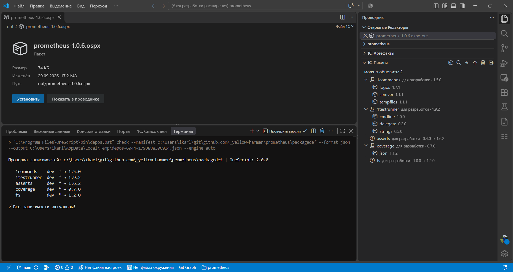

# 1С: Пакеты

>  Какая версия стоит и от какого пакета пришла.

Панель **1С: Пакеты** показывает зависимости проектов окна.

## Список

Прямая зависимость из `packagedef` стоит на первом уровне. Пакет, который пришёл вместе с ней, вложен в того, кто его запросил. Прямая зависимость для разработки подписана «для разработки». Пакет, для которого в списке не видно, кто его поставил, стоит в группе **Ещё установленные**.

После **Проверить версии** у устаревшей строки прежняя и доступная версия через стрелку, например `1.0.0 → 1.2.0`.

## Команды

Те же команды стоят в шапке панели и в группе **Зависимости** дерева **1С: Инструменты**. Кнопки шапки выполняются в проекте выбранной строки. Если строка не выбрана, команда из палитры и из дерева инструментов идёт в текущем проекте.

| Команда | Что делает |
| --- | --- |
| Установить зависимости | Ставит пакеты по `packagedef` |
| Проверить версии | Сравнивает записанные версии с доступными |
| Диагностика зависимостей | Ищет не установленные пакеты, несовпадение версий и пакеты, которые не используются в коде |
| Обновить версии | Записывает новые версии в `packagedef`. Уже стоящие пакеты не меняет |
| Удалить зависимости | Удаляет каталог `oscript_modules` |

На строке прямой зависимости **Обновить версии** записывает версию только этого пакета. После записи можно сразу выполнить **Установить зависимости**.
