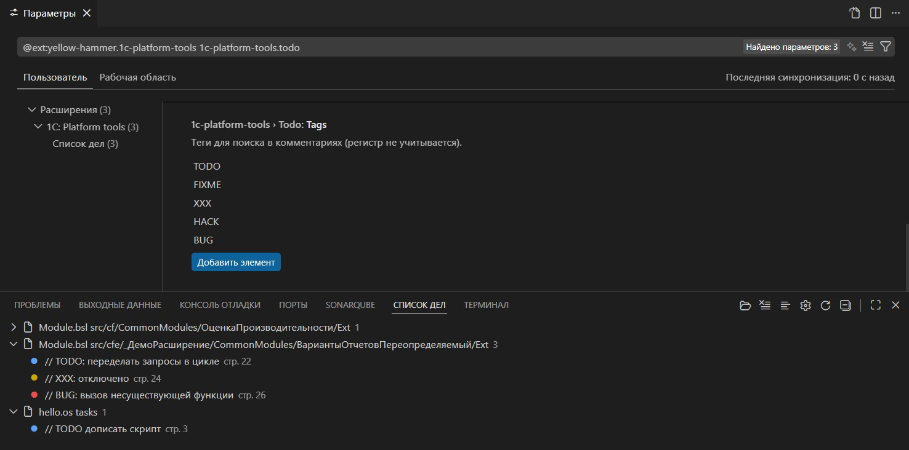

# 1С: Проекты

>  Проект переключается из статусной строки, не выходя из окна.

Проект это каталог с файлом `packagedef`: папка рабочей области или каталог внутри неё. В одном окне проектов бывает несколько, и у каждого свои профили запуска, окружения, база, `.1cpt`, `oscript_modules` и каталог сборки.

Панель **1С: Проекты** показывает проекты окна, находит проекты на диске и переключает между ними, в том числе без открытого проекта.



## Вид проекта

Проект с исходным кодом 1С подписан его форматом: **Конфигуратор** или **EDT**. Проект без исходного кода 1С это **1С**, если его `packagedef` зависит от vanessa-runner, vanessa-automation или add и не объявляет классы, модули или исполняемый файл: так выглядит новый проект до первой выгрузки. Остальные проекты это **OneScript**.

Профиль запуска и окружение в строке состояния есть у проекта любого вида, автономный сервер — у всех, кроме OneScript. Пока открыт файл вне проектов, они скрыты, а запущенный сервер виден всегда. Дерево метаданных у проекта OneScript пишет, что метаданных 1С в нём нет.

## Раскладка проекта

Каталоги исходного кода настраивать не нужно: расширение само находит конфигурацию, её расширения, внешние обработки и отчёты в любом месте проекта и в обоих форматах.

Скрытые каталоги, каталоги сборки и пакетов расширение не просматривает, остальное лишнее исключает настройка `artifacts.exclude`.

## Проекты в окне

В проекте одна конфигурация, всё остальное в его каталоге относится к ней. Каталог внутри проекта со своим `packagedef` и своей конфигурацией это подпроект: на вкладке **Рабочая область** он стоит под родителем, а его расширения, кроме тестовых, есть и у родителя. Каталог с `packagedef` без своей конфигурации, например репозиторий расширения, внешней обработки или пакет OneScript, остаётся частью проекта.

Вторую конфигурацию без своего `packagedef` проект не берёт: она помечена предупреждением, и **Сделать отдельным проектом** кладёт ей `packagedef`. Папки рабочей области без `packagedef`, в которых нашлась конфигурация, собраны в группу **Не проекты**, проектом их делает **Инициализировать проект**.

Настройки путей, тестов, сервера и выбора расширений берутся из папки рабочей области, в которой лежит проект, поэтому у подпроекта они общие с родителем.

## Текущий проект

Команды, дерево метаданных, тесты, профиль запуска и окружение работают с текущим проектом, а артефакты и список дел показывают все проекты, текущий первым. На вкладке **Рабочая область** у строки проекта подписаны его именованный профиль и выбранное окружение. Текущий выбирают на вкладке **Рабочая область**, в списке из строки состояния или кнопкой **Выбрать проект** в заголовке деревьев команд и метаданных. Открытый редактор проект не переключает: команда над файлом или узлом дерева выполняется в его проекте.

Выбор запоминается для окна и в репозиторий не попадает. Пока ничего не выбрано, текущим считается проект из настройки `1c-platform-tools.project.default`, а без неё первый проект в корне папки рабочей области или первый найденный. В окне из нескольких папок эту настройку задают в файле `.code-workspace`.

## Поиск проектов

Вкладка **Все проекты** сканирует указанные папки и ищет каталоги с `packagedef`. Папки поиска задаются настройкой:

```json
{
  "1c-platform-tools.projects.path.baseFolders": [
    "~/projects",
    "D:/work/1c"
  ]
}
```

Если `baseFolders` пуст, вкладка ничего не найдёт, и добавить проект в избранное будет неоткуда. Лишние подпапки исключаются через `projects.ignorePatterns` (например `node_modules`, `out`), глубина сканирования — `projects.maxDepthRecursion`.

## Избранное и теги

- **Избранное** хранит выбранные проекты; отображение — списком или по тегам.
- Теги (например «Личное», «Работа») задаются настройкой `projects.tagList` и назначаются проектам из контекстного меню.

## Быстрое переключение

- Статусная строка показывает текущий проект, а в окне без проекта открытую папку. Клик открывает список: сначала проекты этого окна, выбор делает проект [текущим](#текущий-проект), затем Избранное и Все проекты для открытия.
- Команда **1С: Проекты → Открыть список** — из палитры или по `Ctrl+Alt+P` / `Cmd+Alt+P`.
- Поведение открытия (новое окно, подтверждение, фильтр по полному пути) настраивается ключами `1c-platform-tools.projects.*`.

## Синхронизация

`projects.path.storage` — папка для хранения `projects.json` (избранное и теги); укажите синхронизируемый каталог, чтобы переносить список между машинами. `projects.cacheBetweenSessions` ускоряет открытие панели за счёт кэша результатов сканирования.
