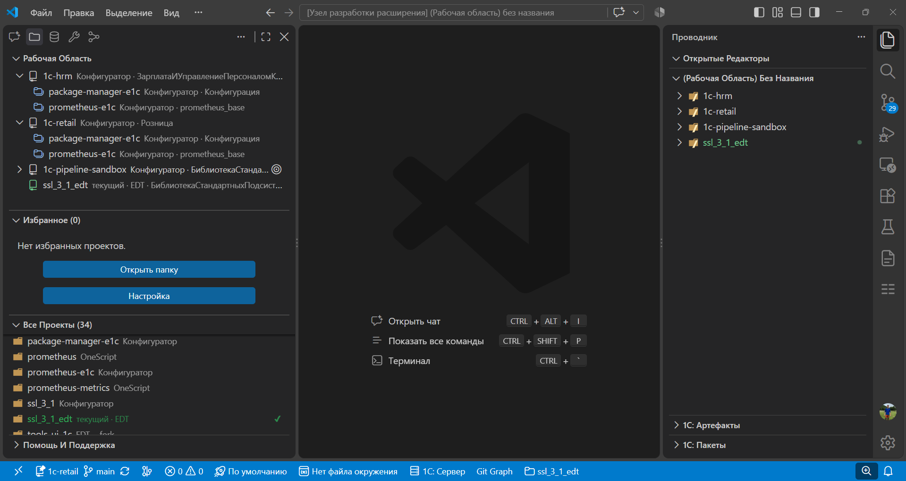

# 1С: Проекты

>  Проект переключается из статусной строки, не выходя из окна.

Проект это каталог с файлом `packagedef`: папка рабочей области или каталог внутри неё. В одном окне проектов бывает несколько, и у каждого свои профили запуска, окружения, база, `.1cpt`, `oscript_modules` и каталог сборки.

Панель **1С: Проекты** показывает проекты окна, находит проекты на диске и переключает между ними, в том числе без открытого проекта.

## Поддерживаемые виды проектов

У строки проекта стоит **Конфигуратор**, **EDT**, **OneScript** или **1С**. Расширение определяет формат само, пути к каталогам настраивать не нужно.

### Конфигуратор

Выгрузка в файлы. Команды над исходниками выполняет платформа.

### EDT

Конфигурация, каждое расширение, обработка и отчёт лежат отдельными проектами 1С:EDT. Общего каталога `src` нет.

Команды, которые читают и записывают эти исходники, выполняет 1С:EDT. Запуск Предприятия и Конфигуратора, сеансы и тесты идут без неё.

Пока открыт редактор EDT или выполняется его команда, следующая команда над исходниками ждёт: рабочая область одна.

Перевод между выгрузкой конфигуратора и проектом EDT делает 1С:EDT. Расширение переводится после конфигурации: ему нужен её проект как базовый.

### OneScript

Пакет на файлах `.os`. Дерево метаданных показывает состав из `packagedef`: классы, модули, программы (`src/main.os`) и задачи.

Сборка даёт `.ospx`. Публикация берёт канал и токен из окружения. Профиль запуска один, `autumn-properties.json`.

### Без исходного кода

Подпись **1С** стоит, пока исходников ещё нет: в `packagedef` есть vanessa-runner, vanessa-automation или add и нет классов, модулей или программы. Дерево метаданных пишет «Исходный код не найден».

## Проекты в окне

В проекте одна конфигурация, всё остальное в его каталоге относится к ней. Каталог внутри проекта со своим `packagedef` и своей конфигурацией это подпроект: на вкладке **Рабочая область** он стоит под родителем, а его расширения, кроме тестовых, есть и у родителя. Каталог с `packagedef` без своей конфигурации, например репозиторий расширения, внешней обработки или пакет OneScript, остаётся частью проекта.

Вторую конфигурацию без своего `packagedef` проект не берёт: она помечена предупреждением, и **Сделать отдельным проектом** кладёт ей `packagedef`. Папки рабочей области без `packagedef`, в которых нашлась конфигурация, собраны в группу **Не проекты**, проектом их делает **Инициализировать проект**.

Настройки путей, тестов, сервера и выбора расширений берутся из папки рабочей области, в которой лежит проект, поэтому у подпроекта они общие с родителем.

## Текущий проект

Команды, дерево метаданных, тесты, профиль и окружение работают с текущим проектом. Артефакты, пакеты и список дел показывают все проекты, текущий первым. Открытый редактор проект не переключает: команда над файлом или узлом дерева выполняется в его проекте.

Выбор запоминается для окна и в репозиторий не попадает. Пока ничего не выбрано, текущим считается первый проект.
