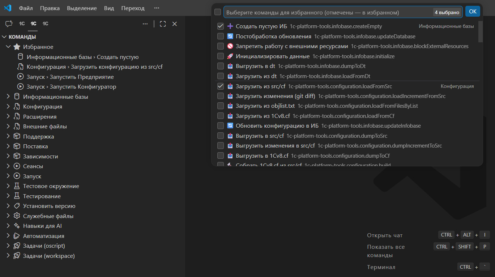

# 1С: Инструменты

>  Команды выполняются задачами VS Code, а не в терминале.

Основное дерево команд в activity bar — **1С: Инструменты**.



## Разделы дерева

- **Информационные базы** — создание, обновление, загрузка/выгрузка DT, инициализация данных.
- **Конфигурация** — загрузка и выгрузка исходного кода, работа с `1Cv8.cf`, инкрементальная загрузка/выгрузка, сборка и разбор. Загрузка из исходного кода есть в двух видах: только в основную конфигурацию и сразу с обновлением конфигурации БД; обновление БД отдельно — «Обновить конфигурацию в ИБ».
- **Расширения** — загрузка и выгрузка исходного кода расширений, работа с `*.cfe`, сборка и разбор.
- **Внешние файлы** — сборка и разбор `epf`/`erf`, очистка кэша.
- **EDT** — стоит перед **Поддержкой**: у выгрузки конфигуратора в ней импорт в проект EDT, у проекта EDT выгрузка в XML, форматирование, сортировка и сведения. Запуск EDT стоит в группе **Запуск** рядом с Предприятием и Конфигуратором, проверка проекта — в группе **Тестирование**. Подписи команд одни для обоих форматов: «исходный код» это каталог выгрузки у конфигуратора и сам проект у EDT. У проекта EDT скрыты только загрузка по списку объектов и по приращению, они считаются по файлам выгрузки.
- **Тестовое окружение** — то, чем тестируют, а не поставляют: тестовые расширения из `tests/cfe` (см. [Тестовые расширения](testing.md#тестовые-расширения)) и сборка/разбор unit тестов из `tests/epf`.
- **Поддержка** и **Поставка** — команды поддержки конфигурации и подготовки файлов поставки.
- **Зависимости** — инициализация `packagedef`, структуры проекта, Git, установка и выбор версии OneScript, OPM и зависимостей.
- **Пакет** — сборка пакета OneScript и установка собранного пакета (см. [Пакет OneScript](#пакет-onescript)). Группа есть у проекта OneScript и у проекта 1С, чей `packagedef` объявляет классы, модули или исполняемый файл.
- **Служебные файлы** — создание `.gitignore`, `.gitattributes`, основного [профиля запуска](launch-profiles.md) и файлов `tools/*` ([service-files.md](service-files.md)).
- **Сеансы** — запрет и разрешение начала сеансов, завершение сеансов, проверка их отсутствия, запрет и разрешение регламентных заданий (см. [Сеансы информационной базы](#сеансы-информационной-базы)).
- **Автоматизация** — пайплайны и хуки команд, см. [Автоматизация](automation.md).
- **Запуск**, **Тестирование**, **Установить версию**, **Конфигурации запуска**, **Навыки для AI**, **Помощь и поддержка**.

В **Помощи и поддержке** есть **Скопировать сводку окружения**. Тот же пункт есть в остальных контейнерах. В сводке у OneScript видно движок проекта: версию, путь, откуда он взят и `ВерсияСреды` проекта.

У [проекта OneScript](projects.md#проект-onescript) в дереве только его группы: **Зависимости** без структуры каталогов vanessa-bootstrap, **Пакет**, **Тестирование** с тестами OneScript, мутационным тестированием и Allure, **Навыки для AI** без навыков 1С, **Автоматизация** и задачи. Выбор видимых групп и окно избранного тоже показывают только их, а избранное других проектов при сохранении не теряется: их цепочки и задачи окно показывает отдельным разделом.

Активный [профиль запуска](launch-profiles.md) выбирается в статусной строке (слева) и подставляется во все команды vrunner.

## Сеансы информационной базы

Группа **Сеансы** готовит базу к обновлению: закрывает вход, завершает оставшиеся сеансы и проверяет, что база свободна. Команды работают через утилиты кластера `rac` и `ras`.

| Команда | Что делает |
|---|---|
| Запретить начало сеансов | Новые сеансы не начинаются; задаются сообщение пользователю и код допуска |
| Разрешить начало сеансов | Снимает запрет |
| Запретить регламентные задания | Останавливает выполнение заданий: запрет входа сам по себе их не гасит |
| Разрешить регламентные задания | Возвращает выполнение заданий |
| Завершить сеансы | Завершает активные сеансы; по умолчанию заодно запрещает начало новых |
| Проверить отсутствие сеансов | Завершается ошибкой, если сеансы найдены |
| Показать сеансы | Список сеансов с приложением, пользователем, компьютером и временем; только 3.x |

**Параметры подключения задаются в профиле запуска, а не в настройках расширения.**  Внутри файла блок команды приоритетнее блока `default`, а сама утилита `rac` находится по версии платформы автоматически.

Для vanessa-runner 2.x в `env.json` (или `env.<профиль>.json`):

```json
"session": {
    "--ras": "srv:1545",
    "--db": "erp",
    "--cluster-admin": "ClusterAdmin",
    "--cluster-pwd": "пароль",
    "--uccode": "код-допуска"
},
"scheduledjobs": {
    "--ras": "srv:1545",
    "--db": "erp"
}
```

Для 3.x в `autumn-properties.json` те же параметры лежат в общей секции кластера:

```json
{
  "vrunner": {
    "cluster": {
      "ras": "srv:1545",
      "db-name": "erp",
      "cluster-admin": "ClusterAdmin",
      "cluster-pwd": "пароль"
    }
  }
}
```

Пароль администратора кластера и код допуска можно не хранить в файле: vanessa-runner читает их из переменных окружения `RUNNER_CLUSTERADMIN_USER` и `RUNNER_CLUSTERADMIN_PWD` (в 3.x - `VRUNNER_CLUSTERADMIN_*`).

Команды работают с серверной базой: у файловой кластера нет, о неприменимости сообщит сам vanessa-runner.

Возможности зависят от версии vanessa-runner: в 2.x нет списка сеансов, в 3.x нет времени начала и окончания блокировки, она применяется сразу. О недоступном действии команда сообщает до запуска. Регламентные задания работают в обеих версиях.

Отбор сеансов задаётся одинаково для обеих версий, записью 2.x: `appid=Designer;1CV8|name=рег1;рег2`. Значения внутри условия перечисляются через точку с запятой, условия объединяются по ИЛИ. Для 3.x расширение раскладывает эту запись на опции `--filter-app` и `--filter-name`, а режим `EXCEPT` превращает во флаг инверсии. Режимы `DEFAULT` и `ALL` есть только в 2.x: в 3.x аналога нет, и команда об этом скажет, а не отбросит отбор молча.

Завершение сеансов в 3.x проверяет результат: `rac` завершает сеансы асинхронно, поэтому vanessa-runner перечитывает список и добивает зависшие. Число попыток задаётся параметром `sessionRetry` (по умолчанию три), а `sessionTimeout` заставляет повторять до успеха или до истечения времени. Проверка отсутствия сеансов с `sessionTimeout` ждёт, пока фоновые задания сами доработают.

При вызове агентом можно задать параметры разового запуска, не трогая профиль: `lockMessage`, `accessCode`, `lockStart`, `lockEnd`, `sessionFilter`, `sessionFilterMode`, `keepSessionsUnlocked`, `sessionRetry`, `sessionTimeout` и `sessionConnections`.

## Выбор расширений для команд

Команды группы **Расширения** (загрузка и выгрузка исходников и `*.cfe`, загрузка из `objlist.txt`, обновление в ИБ, сборка, разбор), а также **Установить версию → Расширения** работают не со всеми найденными расширениями, а с выбранным подмножеством. Это удобно, когда в проекте много расширений, а разработка идёт по нескольким: не нужно ждать, пока отработают все.

Тестовые расширения в этот выбор не входят: у них своя память выбора и своя настройка `1c-platform-tools.test.cfe.selected`, работает она так же. Исключение **Установить версию → Расширения**: версия нужна и тем, и другим, поэтому окно показывает все расширения проекта.

Источник выбора определяется так:

1. **Настройка `1c-platform-tools.cfe.selected`.** Если в `settings.json` задан список расширений — команды используют его **без окна выбора**. Расширение называют именем его каталога, путём к каталогу от корня проекта или именем из метаданных; регистр не важен, названные, которых в проекте нет, пропускаются.
2. **Интерактивный выбор.** Если настройка пуста, при запуске команды показывается выпадающий список с чекбоксами по найденным расширениям:
   - изначально отмечены все;
   - снятый выбор запоминается для проекта (локально, не коммитится) и подставляется при следующем запуске любой команды расширений;
   - если оставить отмеченными все — выбор сбрасывается, и новые расширения подхватываются автоматически.

Собранные `*.cfe` зовутся по каталогу расширения, поэтому команды над файлами (загрузка и разбор `*.cfe`) подчиняются тому же выбору: файл `МоёРасширение.cfe` и каталог `МоёРасширение` для выбора одно и то же расширение.

Пример `.vscode/settings.json` — команды будут работать только с этими двумя расширениями, без окна выбора:

```jsonc
{
  "1c-platform-tools.cfe.selected": [
    "РасширениеПоЗарплате",
    "РасширениеПоБюджетированию"
  ]
}
```

Пустой список (`[]`) или отсутствие настройки возвращает интерактивный выбор.

## Запуск команд: задачи VS Code

По умолчанию команды [vanessa-runner](https://github.com/vanessa-opensource/vanessa-runner) и `opm` (установка зависимостей, запуск oscript-задач), установка OneScript и сборка Allure-отчёта выполняются как **задачи VS Code** (Tasks). Это даёт:

- **«Rerun Last Task».** Последний запуск повторяется командой палитры **Tasks: Rerun Last Task** (по умолчанию без хоткея, можно назначить свой).
- **Запуск из списка задач и `tasks.json`.** Команды видны в **Tasks: Run Task**, их можно вынести в `tasks.json`, навесить хоткей или включить в составную задачу.
- **Единый статус и вывод.** Прогон идёт в панели задачи; вывод виден полностью, задачу можно остановить (она завершает всё дерево процессов `cmd → oscript → 1cv8`).
Отключить и вернуться к обычному интерактивному терминалу можно настройкой `1c-platform-tools.execution.useTasks: false`.

### Сигнал о завершении

Когда команда закончилась, расширение подаёт короткий звук и пишет исход в строку состояния: `Загрузка конфигурации: готово за 2 мин 15 с` либо `Синтаксический контроль: ошибка, код 1 (5 с)`. Успех и ошибка звучат по-разному, подробности остаются в журнале расширения. Пайплайн сообщает о себе один раз, по итогу всей цепочки («готово за 4 мин, шагов 6» или «ошибок 1 из 6»), отдельные шаги молчат.

- `1c-platform-tools.notifications.onCommandFinish` — `always` (по умолчанию), `onError` или `never`.
- `1c-platform-tools.notifications.sound` — звук, по умолчанию включён.

Звук берётся из системы: на Windows - звуковая схема («Звуковое уведомление» и «Критическая ошибка»), на macOS - `afplay` со стандартными звуками, на Linux - `paplay` со звуковой темой freedesktop. Если проигрывателя или звуковой темы в системе нет, сигнал молча пропускается, строка состояния и журнал остаются.

Сигнал приходит для команд, запущенных задачами VS Code. При `execution.useTasks: false` расширение о завершении не знает: команда живёт в интерактивном терминале.

### Свои задачи в `tasks.json`

Команды vrunner можно описывать вручную в `.vscode/tasks.json` (тип `1c-vrunner`):

```jsonc
{
  "version": "2.0.0",
  "tasks": [
    {
      "type": "1c-vrunner",
      "command": "vanessa",
      "args": ["--settings", "env.json"],
      "label": "1С: Прогнать Vanessa",
      "group": "test"
    },
    {
      "type": "1c-vrunner",
      "command": "compile",
      "args": ["--src", "src/cf"],
      "label": "1С: Собрать конфигурацию"
    }
  ]
}
```

Запуск — **Tasks: Run Task** → выбрать задачу. Поле `command` — это команда vrunner (`vanessa`, `compile`, `syntax-check`, `init-dev` и т.д.), `args` — её аргументы.

### Клики по путям в выводе

В выводе команд пути кликабельны: клик открывает исходник, а если рядом указан номер строки, курсор встаёт на неё.

Разбираются три записи:

- путь к файлу с номером строки или без: `Catalogs/Валюты/Ext/ObjectModule.bsl:12`, `./features/Валюты.feature`;
- сообщение OneScript вида `Модуль <путь>.os / Ошибка в строке: 188`;
- путь по метаданным: `HTTPСервис.Биллинг.Модуль`, в конце может стоять номер строки в скобках.

Путь по метаданным ищется в текущем проекте: в конфигурации, в расширениях и в остальных найденных в нём конфигурациях. Формат исходников берётся у каждого каталога, поэтому в проекте могут лежать и выгрузка конфигуратора, и проект EDT.

## Установка OneScript

Команда **Установить OneScript** в разделе **Зависимости** ставит выбранную версию через [OVM](https://github.com/oscript-library/ovm): сам `ovm.exe` расширение загружает и обновляет как [внешний компонент](components.md).

Версия ставится рядом с уже установленными: `ovm install` без `ovm use`, версия для всей машины не меняется. Только первая установка становится и версией машины: других ещё нет, а терминалам и проектам нужен хоть какой-то движок. Проект, из которого поставили версию, дальше работает ею: если сам он нашёл бы другую установку, версия выбирается для него, как командой **Выбрать версию OneScript**.

**Выбрать версию OneScript** показывает установки OVM и отмечает те, что ниже `ВерсияСреды` проекта. Выбор хранится у проекта, а не в настройках папки: подпроекты одной папки выбирают движок каждый для себя. Пункт **Автоматически** выбор снимает.

### Какая установка OneScript используется

У каждого проекта свой движок. Порядок такой:

1. настройка `1c-platform-tools.components.path.oscript`, если задана;
2. установка OVM, выбранная для проекта командой **Выбрать версию OneScript**;
3. движок машины, если он не ниже `ВерсияСреды` в `packagedef`: текущая установка OVM (`%LOCALAPPDATA%\ovm\current\bin`, каталог OVM меняет переменная `OVM_INSTALL_PATH`), а без неё `oscript` из `PATH`;
4. установка OVM версии из `ВерсияСреды`, а если такой нет, самая новая той же старшей версии, но не ниже: библиотеки 1.x и 2.x движка разные.

`ВерсияСреды` для opm — наименьшая версия движка, на которой пакет ставится, поэтому движок машины, который не ниже, проект не меняет. Если подходящей установки нет, остаётся движок машины: перед запуском команд и тестов расширение один раз за сессию предупреждает, что он ниже `ВерсияСреды`, и предлагает выбрать или установить версию. Запуск предупреждение не останавливает.

opm берётся из той же установки, что и движок, а `OSCRIPTBIN` указывает на её `bin`: команды пакетов, поставленных не в проект, ложатся рядом с движком, а не в `/usr/bin`.

Установка OVM идёт раньше `PATH` намеренно. Windows склеивает `PATH` как системная часть плюс пользовательская, а OVM прописывается в пользовательскую, поэтому каталог другой установки почти всегда оказывается раньше. Каталог выбранной установки подставляется первым в `PATH` и в переменные `OVM_OSCRIPTBIN` и `OSCRIPTBIN`: и дочерним процессам расширения, и новым терминалам. Без этого обёртки `opm.bat` и `vrunner.bat`, которые запускают `oscript` по имени, увели бы работу в чужую установку: автозапуск cmd, который оставляет `ovm use`, ставит в `PATH` каталог из `OVM_OSCRIPTBIN`.

После установки OneScript расширение перечитывает выбор само, перезапускать VS Code не нужно. Новые терминалы получают движок текущего проекта, а на Linux и macOS с интеграцией оболочки и после строк, которые `ovm use` пишет в `.bashrc`. Уже открытых терминалов правка не касается: их окружение задано при запуске.

Какая установка выбрана, видно в журнале расширения (**Output** → **1C: Platform Tools**) строками вида `oscript: используется установка OVM`.

Сам OVM тоже идёт за дистрибутивом в сеть, поэтому на закрытой машине OneScript ставится переносимой сборкой: [OneScript без прав администратора](components.md#onescript-без-прав-администратора).

## Пакет OneScript

**Собрать пакет** выполняет `opm build -o build/out/ospx` в корне проекта: получается `<Имя>-<Версия>.ospx` из `packagedef`. Каталог сборки задаёт `1c-platform-tools.path.out`. Собранный пакет виден в [артефактах](artifacts.md).

**Установить собранный пакет** ставит `.ospx` в движок проекта командой `opm install -f`, как пакет из хаба: с зависимостями и командой приложения. Без выбранного файла берётся пакет версии из `packagedef`, а если их несколько, расширение спрашивает, какой. Та же команда есть у пакета в дереве артефактов.

Зависимости из `РазработкаЗависитОт` в пакет не входят, их ставит **Установить зависимости** (`opm install --dev -l`).

Публикацию в хаб (`opm push`) расширение не делает: ей нужен токен хаба, а канал выпуска opm выбирает по ветке. Это шаг CI, как в workflow autumn-library.

## Где расширение ищет платформу и EDT

Платформу 1С и 1С:EDT ставят их собственные установщики, расширение их находит.

Платформа ищется сначала в каталогах из параметра `InstalledLocation` файлов `1cestart.cfg`: установщик пишет туда, куда поставил платформу, в общий файл при установке «для компьютера» и в файл пользователя при установке «для пользователя». Затем в местах установки по умолчанию:

| ОС | Каталоги |
| --- | --- |
| Windows | `%ProgramFiles%\1cv8`, `%ProgramFiles(x86)%\1cv8`, `%LOCALAPPDATA%\Programs\1cv8_x64`, `%LOCALAPPDATA%\Programs\1cv8` |
| Linux, macOS | `/opt/1cv8/<архитектура>`, `/opt/1C/v8.3/<архитектура>` |

Версия выбирается сразу по всем найденным каталогам.

EDT ищется среди сред, установленных через 1C:EDT Start, в том числе в каталоге сред разработки из его настроек, и в каталоге компонентов установщика 1С: `%ProgramFiles%\1C\1CE\components`, `/opt/1C/1CE/components`, `/Applications/1C/1CE/components`.

Установку в другом месте задают настройками `1c-platform-tools.platform.path` и `1c-platform-tools.edt.path`. Заданный каталог единственный: другие места расширение уже не проверяет. Что нашлось, видно в сводке окружения.

## Загрузка и обновление конфигурации БД

Загрузка исходников и применение их к конфигурации БД (`UpdateDBCfg`) — разные действия: первое меняет основную конфигурацию, второе переносит код и структуру в базу. Обновление вынесено в отдельную команду **1С: Обновить конфигурацию в ИБ**, но оба vanessa-runner умеют сделать и то, и другое одним запуском конфигуратора, поэтому команды загрузки спрашивают об этом до старта.

Постоянный ответ задаётся настройкой `1c-platform-tools.cf.load.updateDb`:

| Значение | Поведение |
|----------|-----------|
| `ask` (по умолчанию) | спрашивать при запуске команды |
| `always` | всегда обновлять конфигурацию БД тем же запуском |
| `never` | только загружать |

Настройка действует на загрузку из исходного кода, из `1Cv8.cf`, по `objlist.txt` и на загрузку расширений.

Вопрос задаётся только тому, кто запускает команду руками. Агент, MCP, шаг пайплайна и хук вопроса не получают: значение `ask` означает для них загрузку без обновления, а нужное поведение задаётся параметром `updateDb` в параметрах вызова.

На vanessa-runner 2.x загрузка изменений (`git diff`) без обновления конфигурации БД невыразима: список изменённых файлов собирает сама команда `update-dev` вместе с обновлением. В этом случае исходники загружаются целиком, о чём расширение сообщает замечанием; на 3.x ограничения нет.

## Путь и имя собранного файла

Агент и шаг пайплайна задают, куда положить собранный или выгруженный файл, двумя параметрами вызова:

- `outputDirectory` - каталог, относительно корня проекта или абсолютный;
- `outputName` - имя файла без расширения, расширение ставится по типу файла.

Их принимают сборка и выгрузка конфигурации (`cf.compile`, `cf.unload`, `cf.makeDist`), расширений (`cfe.compile`, `cfe.unload`), сборка внешних обработок и отчётов (`epf.compileProcessor`, `epf.compileReport`). Без параметров файлы ложатся в каталог из настройки `1c-platform-tools.path.out` под привычными именами.

В оба параметра подставляются переменные:

| Переменная | Значение |
|---|---|
| `${name}` | имя объекта в метаданных |
| `${folder}` | имя каталога исходного кода |
| `${version}` | версия конфигурации или расширения из исходного кода |
| `${gitBranch}` | текущая ветка git, как в [профиле запуска](launch-profiles.md) |

```json
{ "id": "release", "type": "command", "command": "1c-platform-tools.cfe.compile", "options": { "outputDirectory": "build/release/${gitBranch}", "outputName": "${name}-${version}" } }
```

- Для внешних обработок и отчётов нужен vanessa-runner 3.
- У внешних обработок и отчётов версии нет. При выгрузке из базы неизвестны имя и версия конфигурации и версия расширения. Такая переменная останавливает команду до запуска.
- Если несколько объектов получают один файл, команда не запускается и перечисляет их.
- В Docker файлы конфигурации и расширений пишет контейнер, ему виден только каталог проекта.
- Собранные файлы возвращаются в результате команды списком `artifacts`.
- Загрузка и разборка из файлов берут их из привычных мест: файл под другим именем или в другом каталоге они не увидят.

## Избранное и палитра

- Часто используемое добавьте в избранное: **1С: Инструменты → Избранное** — раздел «Избранное» появится вверху дерева. В списке кроме команд есть цепочки проекта и задачи oscript.
- Все команды доступны из палитры (`Ctrl+Shift+P` → введите «1C»).

## Скрытие групп

Ненужные группы дерева **Команды** можно скрыть: кнопка-глаз в шапке плашки (справа от «Избранного») открывает список групп с чекбоксами — снимите отметку, чтобы скрыть. Когда что-то скрыто, значок меняется на перечёркнутый глаз.

Выбор хранится на пользователя (не в `settings.json` проекта). «Избранное» не затрагивается: закреплённые команды остаются видны независимо от скрытых групп.

## Уведомления

Рутинные подтверждения (дерево обновлено, файл создан, свойства сохранены) показываются в строке состояния и исчезают сами; полный след остаётся в журнале расширения (**Выходные данные** → «1C: Platform Tools»). Всплывающие окна оставлены для ошибок, предупреждений и сообщений с кнопками.

## Доверие к папке

 В режиме ограниченной функциональности расширение не запускает программы по проекту. Не работают команды 1С и vrunner, прогон тестов из панели тестирования, команды 1С:EDT, запуск баз из списка, консоль кластера, автономный сервер, отладка, цепочки и хуки, установка OneScript и зависимостей. Панели, дерево команд и просмотр метаданных работают: метаданные читает собственный компонент расширения, он загружается и запускается как обычно. После того как папке доверили, деревья перечитываются и команды выполняются обычным образом.

Отказ везде один: папка не доверенная, расширение не запускает код из неё. Команда, запущенная задачей, пишет его в терминал задачи, вызванная из панели или палитры показывает всплывающее окно, дерево кластеров показывает узлом.

В недоверенной папке агент команды не выполняет. То же у файла-триггера `.cursor/1c-platform-tools-run-command`.

Настройки, которые ведут к исполняемым файлам (`vrunner.path`, `components.path.oscript`, пути платформы, `docker.image` и подобные) и включают запуск задачами (`execution.useTasks`), в недоверенной папке берутся не из проекта, а из пользовательских: иначе открытая папка могла бы подменить запускаемую программу или сама себе открыть доступ.

## Настройки

- `1c-platform-tools.path.out`, `1c-platform-tools.path.dist` — каталоги результатов сборки и шаблонов поставки.
- `1c-platform-tools.cfe.selected` — список расширений (имя каталога, путь от корня проекта или имя расширения, регистр не важен), с которыми работают команды группы «Расширения» и установка версии расширений. Пусто — интерактивный выбор с запоминанием, см. [Выбор расширений для команд](#выбор-расширений-для-команд).
- `1c-platform-tools.test.cfe.selected` — то же для тестовых расширений.
- `1c-platform-tools.vrunner.*` — путь и параметры vanessa-runner; по умолчанию используется `oscript_modules/bin/vrunner.bat` проекта, если он есть.
- `1c-platform-tools.execution.useTasks` — запускать команды как задачи VS Code (Rerun Last Task, запуск из списка задач); по умолчанию `true`. `false` — обычный интерактивный терминал.
- `1c-platform-tools.notifications.onCommandFinish`, `1c-platform-tools.notifications.sound` — сигнал по завершении команды, см. [Сигнал о завершении](#сигнал-о-завершении).
- `1c-platform-tools.docker.*` — выполнение команд в контейнере с платформой, см. [Docker и ibcmd](docker.md).
- `1c-platform-tools.components.*` — пути к внешним компонентам и их автозагрузка, включая выбор `oscript.exe`; см. [Внешние компоненты](components.md).
- Выполнение в Docker — [docker.md](docker.md).
