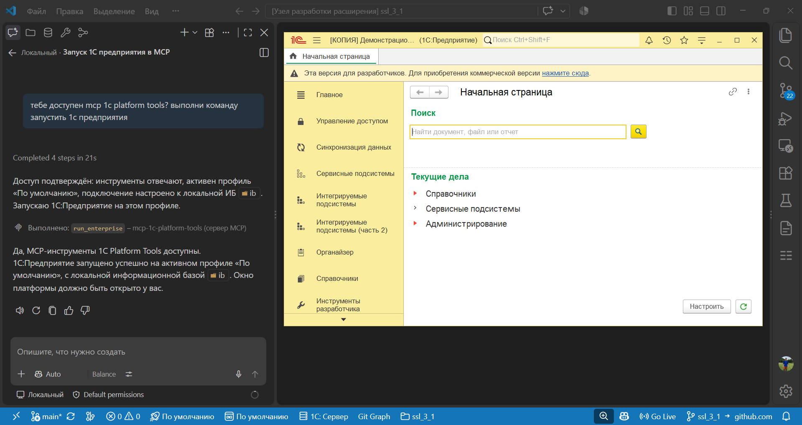

# Шаг 16: Интеграция с AI и MCP

Расширение помогает AI-агентам (Cursor, Claude, Copilot) работать с проектом 1С: агент узнаёт, какие команды вызывать, и может выполнять их через навык или MCP.

**Навыки для агента.** В группе «Навыки для AI» ставятся навыки разработки 1С (cc-1c-skills, с GitHub), навыки команд расширения, а также навыки OneScript, Vanessa Automation, YAxUnit и xUnit: тоже с GitHub, при каждом вызове. Для последних правила кладутся в каталог того же агента, что и навыки: Cursor, GitHub Copilot или Claude Code. Выберите команду и папку назначения.

**Запуск по файлу.** Если агент умеет создавать файлы, он может записать в `.cursor/1c-platform-tools-run-command` одну строку: идентификатор команды (например `1c-platform-tools.run.designer`). Расширение выполнит команду и удалит файл.

**MCP.** Установите расширение [1C: Platform Tools MCP](https://marketplace.visualstudio.com/items?itemName=yellow-hammer.mcp-1c-platform-tools). Как подключить его в VS Code и Cursor: в разделе [MCP-сервер](https://yellow-hammer.github.io/vscode-1c-platform-tools/mcp/).
