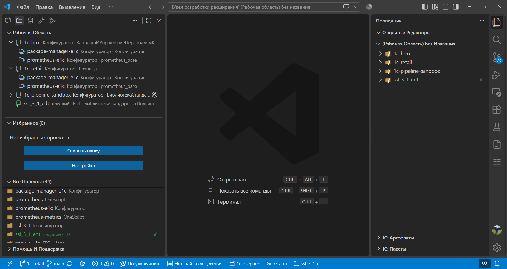

# Шаг 3: 1С: Проекты

Если вы работаете с несколькими проектами 1С, панель **«1С: Проекты»** на боковой панели поможет быстро переключаться между ними.

Укажите в настройках **baseFolders** — папки, где расширение будет искать проекты (каталоги с `packagedef`). **ignorePatterns** исключит ненужные подпапки (например `.git`, `out`). Найденные проекты появятся в разделе «Все проекты». Добавьте нужные в **избранное** и организуйте их тегами (Личное, Работа). Быстрый выбор — команда «1С: Проекты → Открыть список» или `Ctrl+Alt+P`.

У строки проекта подписан формат. Расширение определяет его само.

**1C:Конфигуратор**, подпись **Конфигуратор**. Выгрузка конфигуратора. Остальные панели описаны для него.

**1C:EDT**, подпись **EDT**. Те же панели. Командам над исходным кодом нужна установленная 1С:EDT. Без неё остаются тесты, сеансы и запуск Предприятия и Конфигуратора.

**OneScript**. В дереве метаданных состав пакета: классы, модули, программы и задачи. Публикация отправляет собранный `.ospx`. Канал и токен берутся из настроек окружения.

Пока исходного кода нет, новый проект 1С подписан **1С**.
