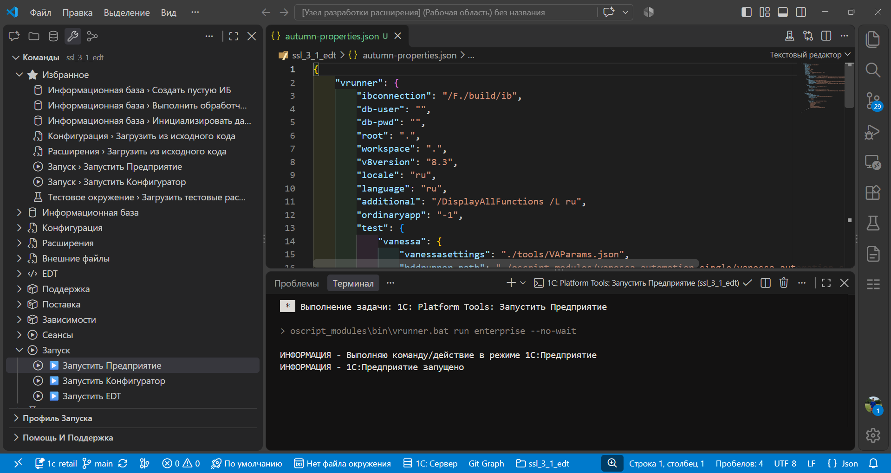

# Шаг 5: 1С: Инструменты

После открытия проекта на боковой панели появляется раздел **«1С: Инструменты»** с деревом команд.

**Дерево** группирует команды по смыслу: информационные базы, конфигурация, расширения, запуск, тестирование и др.

Чтобы не искать нужное каждый раз — добавьте часто используемые в **избранное** через **«Избранное»**.

Команды также доступны из палитры: нажмите `Ctrl+Shift+P` и введите **«1C»** — фильтр покажет все команды расширения.
