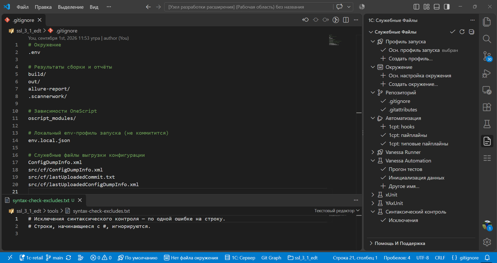

# Шаг 6: 1С: Служебные файлы

Панель **«1С: Служебные файлы»** собирает вспомогательные файлы проекта: профиль запуска, окружение, исключения Git и параметры тестов.

Щелчок по отсутствующей строке создаёт файл. Щелчок по профилю, файлу Vanessa Runner или окружению выбирает его, кнопка строки открывает файл для правки.

**Осн. профиль запуска** задаёт строку подключения к ИБ. Базовый набор создаёт его целиком, со всеми секциями команд, вместе с `.gitignore` и `.gitattributes`.
